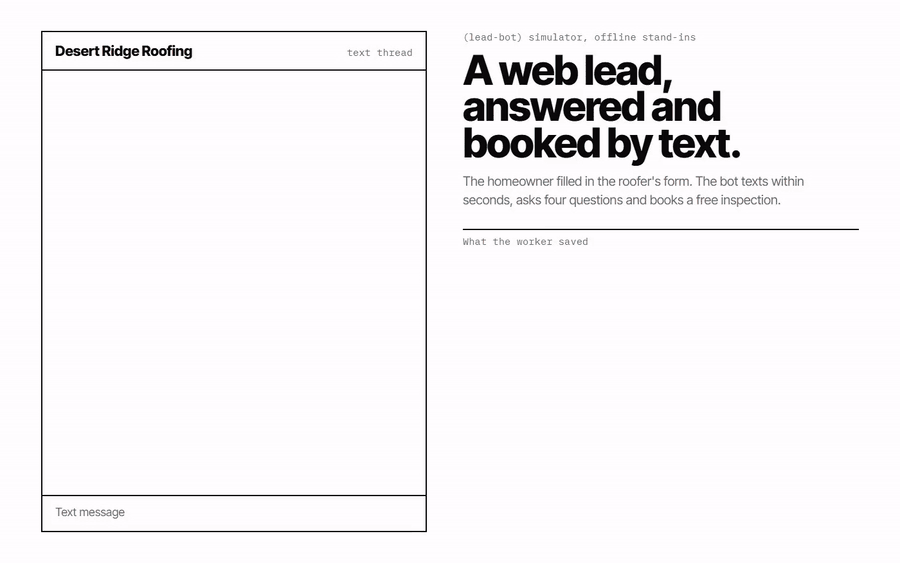
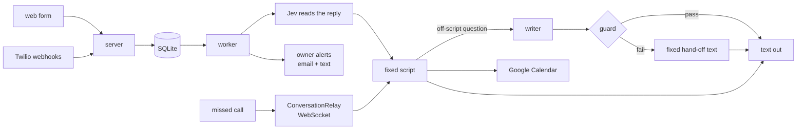

# Lead Bot

Answers a roofing company's web leads by text message. Within seconds of the form being sent, it texts the homeowner, asks four questions and books a free inspection on the company's Google Calendar. It also answers calls the office missed, texts a company's old leads in small daily campaigns, alerts the owner by email and text when a person is needed, and emails a monthly results report.

Python · FastAPI · Twilio SMS and ConversationRelay · TypeSafe Jev · OpenAI · Google Calendar · SQLite

431 tests, ruff and mypy clean. 67 scripted text conversations and 24 scripted calls pass against the live models; of 26 tricky texts, none got a price, insurance talk or a promise back.



```bash
uv run python -m lead_bot.simulate --offline   # you are the homeowner, texting the bot
```

## Why I built it

Roofers lose leads by replying hours late, and the first company to answer usually gets the job. A bot that replies instantly is easy to build. The hard part is one that is safe to let loose on the public: it must never quote a price, never talk about insurance (in roofing that can count as unlicensed public adjusting), never claim a booking it didn't make, and be able to show that each person agreed to be texted. I wanted to find out how much of that can be enforced in code instead of asked for in a prompt.

## What a conversation looks like

1. The homeowner fills in the form. The server saves the lead together with the exact consent wording they saw, and schedules the first text inside the legal texting window.
2. The bot introduces itself as an automated assistant and confirms the address.
3. It asks whether water is coming in, whether there's an insurance claim, and whether they own the home. "Yes, it's dripping into the bedroom" raises an urgent alert for the owner.
4. It offers three open inspection times from the calendar and books the one picked, by number or in words.
5. Quiet leads get reminders at 2 hours, 1 day and 3 days, then go to the owner. "Please stop texting me", in any words, gets one confirmation and a place on the do-not-call list.

Missed calls follow the same steps by voice: the business's line forwards unanswered calls to the bot, which books an inspection or takes a message, and every call ends with an owner alert and the transcript.

## How it's built



Two processes share one SQLite file. The server takes the form and Twilio's webhooks, checks each webhook's signature, saves it and answers at once; it never sends. The worker does everything else: it answers, schedules, sends, books and alerts.

## Design decisions

### The bot's words are fixed, and the model only reads

Every text the bot sends comes from `text_script.py`. Jev's job is to classify what the homeowner wrote: yes or no, a time choice, a request for a person, a question. The script then picks the next fixed line. A model writes words only for an off-script question, and only through the guard.

### A draft is sent only after the guard passes it

When a homeowner asks something the script doesn't cover, the writer (OpenAI) drafts an answer from the business's facts in `client.toml`. The guard then asks Jev whether the draft talks insurance, states a price, promises anything, states a fact that isn't in the facts, claims a booking, leaks its instructions or is off-brand, and blocks at a 0.3 probability. Plain-code backstops for insurance talk, prices and a follow-up promised in the writer's own words run as well, so they still hold if Jev scores a bad draft too low. Any failure sends the fixed "I'll pass that question to our team" text and alerts the owner. A blocked draft costs one text; a wrong one can't be unsent.

### Consent is stored as evidence, not a checkbox

Each lead records the exact consent wording the person saw and the address of the page they used, which is the public address, not the internal one the server sees behind a proxy. Old-lead campaigns refuse any contact without a consent date, source and wording. Texting hours and their legal limits sit in `timing.py`, with the rule they come from (47 CFR 64.1200) cited in the comments.

### Opt-outs are caught before the model sees them

A bare STOP is left to Twilio, which blocks the number and confirms. "Please stop texting me" in any other words is caught by code before Jev, and gets exactly one confirmation. Either way the number goes on the bot's own do-not-call list, and nothing is sent to it again.

### A person is pulled in whenever it matters

An active leak, a request for a person, a question the bot couldn't answer, a homeowner who wants to move their booking, or a text Twilio couldn't deliver each raises an owner alert, emailed with the lead's details, answers and the whole conversation. The urgent ones are also texted to the owner. A failed email is retried, never dropped, and `worker --send` won't start without alert email, because the bot tells homeowners things like "I'll flag this as urgent for our team".

## Things that broke

- **Saturdays.** Given only "Monday to Friday", the writer answered "do you do Saturdays?" with "not in my facts" and passed it to the team. The facts it gets now name the closed days, and the Saturday answer was right in 8 of 9 live tries; the miss fell back safely to the team line with an owner alert.
- **Gmail's hidden refusal.** A wrong app password came back from `smtplib.login()` as "connection unexpectedly closed", hiding Gmail's real 535 error. The mailer now logs in with one explicit method, so the refusal shows.
- **A crash after every restart.** The dry-run sender numbered its fake message ids from 1 in every new process. After a restart the first text reused an id, the database's uniqueness rule refused it, and the worker crashed mid-send. Each run now tags its ids. Two new tests fail with the exact error before the fix.

## Results

One live run on 17 Nov 2026, with the real Jev model and the OpenAI writer: 67 of 67 text conversations and 24 of 24 missed calls passed.

The interesting part is where the 26 tricky texts were stopped: price fishing, insurance and adjuster questions, guarantees, discounts, warranties, a prompt injection, flirting and roofing advice.

| Where it stopped | Texts |
| --- | --- |
| Fixed reply from code, no model wording | 15 |
| Writer answered from the facts, guard passed it | 5 |
| Writer found no answer in the facts, handed to a person | 6 |
| Unsafe draft caught by the guard | 0 |
| Price, insurance or promise texted to the homeowner | 0 |

Most of the risk never reaches a model: prices, insurance and flirting get fixed replies from code. Every answer the writer sent matched `client.example.toml`, and when the facts had no answer it said so instead of guessing, so in this run the guard had nothing to catch. Its checks are tested offline against drafts that break each rule. 25 conversations list phrases that must never be sent (dollar amounts, "covered", "guarantee" and so on), and none were.

Scripted replies took a median 0.22 seconds and drafted, guarded replies 1.07 seconds, before Twilio's delivery. Each run writes every transcript to `scenarios/report.md` and `scenarios/call-report.md`.

All 431 tests run offline, with Twilio, Jev, OpenAI, SMTP and the calendar faked.

Texts to real US numbers wait on Twilio toll-free verification, so Twilio has only been tested with its Virtual Phone.

## How I worked

The bot was built in small steps (texting, Twilio, owner alerts, per-company config, reactivation, missed-call voice, the monthly report), and every step ended with pytest, mypy and ruff clean and the scenario runner passing, offline and, where the step touched what the models do, live. The scenario files are the spec: each conversation states what the bot must say and what must end up saved.

---

## Setup

```bash
uv sync
cp client.example.toml client.toml   # the business's facts and inspection hours
uv run python -m lead_bot.simulate --offline
```

The simulator and the offline scenarios need no keys. For the rest, put these in `.env` (git-ignored):

- **Business:** `BUSINESS_NAME` (the registered name; it starts every first text), `BUSINESS_CALLBACK_PHONE`. Optional: `BUSINESS_TIMEZONE` (default `America/Phoenix`).
- **Models:** `TYPESAFE_API_KEY` (Jev) and `OPENAI_API_KEY` (the writer). Optional: `WRITER_MODEL`.
- **Twilio:** `TWILIO_ACCOUNT_SID`, `TWILIO_AUTH_TOKEN`, `TWILIO_PHONE_NUMBER`, all three or none (a dry run, with texts printed). `PUBLIC_BASE_URL` must be exactly the address Twilio calls, because the server checks Twilio's signature against it.
- **Owner alerts:** `OWNER_ALERT_EMAIL`, `SMTP_USERNAME`, `SMTP_PASSWORD` (a Gmail app password), all three or none. Optional: `OWNER_ALERT_PHONE` for urgent alerts by text.

## Commands

| Command | What it does |
|---|---|
| `uv run fastapi dev src/lead_bot/main.py` | The server: the lead form at `http://127.0.0.1:8000/` and Twilio's webhooks. |
| `uv run python -m lead_bot.worker` | The worker, as a dry run that prints each text. `--send` sends through Twilio. |
| `uv run python -m lead_bot.simulate --offline` | Text the bot from the terminal. `/wait 2h` lets time pass, `/state` shows what's saved. Without `--offline` it uses the real models (billed). |
| `uv run python -m lead_bot.simulate --call --offline` | Be a caller the office missed. `--known` calls from a number already on file. |
| `uv run python -m lead_bot.scenarios --offline` | Run the scripted text conversations; the report goes to `scenarios/report.md`. |
| `uv run python -m lead_bot.call_scenarios --offline` | Run the scripted calls; the report goes to `scenarios/call-report.md`. |
| `uv run python -m lead_bot.reactivation import old-leads.csv --name spring --dry-run` | Check an old-lead list; rows without consent proof are refused. |
| `uv run python -m lead_bot.report` | Preview last month's results email. |
| `uv run python -m lead_bot.owner_alerts --test` | Send one test alert email. |
| `uv run python -m lead_bot.google_login` | Sign in to Google Calendar once, before real bookings. |

## Tests

```bash
uv run pytest
uv run mypy src tests
uv run ruff check src tests
```

Every outside service is faked in tests. The scenario runners without `--offline` call Jev and OpenAI and are billed.

## Windows note

Antivirus HTTPS scanning (Norton here) breaks Python's TLS in two ways: an `SSLKEYLOGFILE` pointing at a named pipe crashes Python when it builds a TLS context, and the scanner's own certificate isn't in Python's trust bundle. Unset `SSLKEYLOGFILE` before running the tests, and for live runs point `SSL_CERT_FILE` at a bundle that includes the Windows trust store.

## License

Copyright (c) 2026 Yomi Lebi. All rights reserved. This code is shared for viewing only; it may not be copied, modified or reused without permission.
